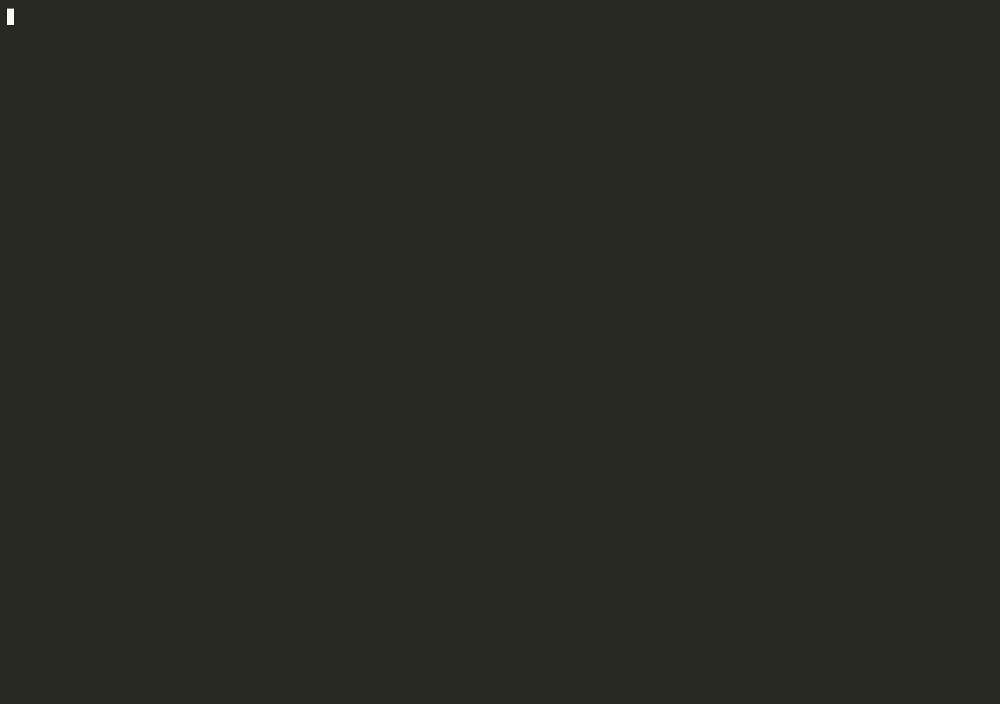

# akg

A Claude Code plugin that sets up Claude Code on a project from an optional **team config**, by asking a few questions about the project, then keeps it in sync with the team.



- **Scans first**: manifests, README, CI, tests and recent commits — stack, test/lint/build commands, monorepo sub-projects.
- **Shows what it understood**: purpose, key folders, architecture, integrations — and lets you add what matters ("edge functions are in `supabase/functions`", "we do DDD"). It lands in a `Project context` section of `CLAUDE.md` you own.
- **Asks every question, pre-filled**: project type, Definition of Done, TDD, review level, Claude autonomy (several picks), dependencies, where commands run (host or container), local tools and shortcuts, architecture, secrets, ticket tracker by default; deployment, branching, tests, migrations, docs… on demand; plus your team's. Asked as an interview, in plain text: answer 1 is akg's guess with its evidence (team, project or scan), the other options are numbered after it. Type "ok", a number, or your own words; a recap of every answer comes before anything is written.
- **Generates**: `CLAUDE.md` (one per sub-project in a monorepo), `.claude/settings.json` (permissions from your answers, with `ask` on install commands and on destructive commands of detected tools such as `terraform apply`), and the plugins to enable.
- **Speaks your language**: questions are asked in the language of the conversation; generated files stay in English unless you choose otherwise.
- **Never imposes**: every file is shown before it is written; every value, setting and plugin is a proposal. Local choices always win over the team's.

## Install

```
/plugin marketplace add anthonykgross/akg
/plugin install akg@akg
```

## Quickstart

A typical case: you open a React app, and your team keeps its Claude Code conventions in a team config (here the folder `../team`; usually a repo such as `github:acme/claude-team`). To replay it yourself: `fixtures/try.sh extends-local-team`.

**1. Run `/akg:setup`.** akg reads the project and the team config before asking anything, then asks which team config to extend (its guess: the one it found) and shows what it understood. Reply `ok`, or correct it in your own words.


**2. Answer the questions.** Answer 1 is always akg's guess, with where it comes from. Values the team already sets come up to three at a time, to confirm. Reply `ok`, a number (`2`, `B2`), or free text.


**3. Approve the recap, then the plugins.** Each answer shows its source (`team` or `you`). Plugins come from the team's marketplace, each with the reason it fits; the others are left out.


**4. Review the files.** Each one is shown before it is written. `CLAUDE.md` (excerpt; the conventions come from the team's frontend template):

```markdown
## Workflow
1. Write a failing test first, then the code, then refactor.
2. Implement the change.
3. Review: re-read the diff, run `npm test` and `npm run lint` before handing over.
4. Done when:
   - [ ] `npm test` passes
   - [ ] `npm run lint` is clean
   - [ ] docs updated (README)

## Conventions
- Components in PascalCase, one component per file.
- Every component has a test next to it (`Foo.test.jsx`).
```

`.claude/settings.json`:

```json
{
  "permissions": {
    "allow": ["Bash(npm test)", "Bash(npm test *)", "Bash(npm run lint)", "Bash(npm run lint *)"],
    "ask": ["Bash(git commit *)", "Bash(git push *)", "Bash(rm *)"],
    "deny": ["Read(**/.env*)", "Bash(git push --force *)", "Bash(git push * main)"]
  },
  "extraKnownMarketplaces": { "acme-team": { "source": { "source": "directory", "path": "../team" } } },
  "enabledPlugins": { "code-review@acme-team": true, "react-conventions@acme-team": true }
}
```

`.claude/akg/config.yaml`, with only what differs from the team:

```yaml
extends: ../team
synced: 599ec89…
workflow:
  type: product
  autonomy: []
tracker:
  tool: jira
  url: https://acme.atlassian.net
  project: ACME
  hosting: cloud
deploy:
  target: kubernetes
  namespace: frontend
```

**5. Commit** `.claude/` and `CLAUDE.md`: teammates get the same setup. When the team changes its config, the next session shows `akg: team config updated — /akg:pull`.

No team config yet? Answer `None` at step 1: the same flow runs on akg's defaults. To create one for your team: `/akg:source-init` in an empty folder.

## Usage

| Command | When |
|---|---|
| `/akg:setup` | Once per project: link the team config (or none), confirm what was detected and understood, answer the pre-filled questions, review the generated files. |
| `/akg:source-init` | Once per team, in an empty folder: creates the team source (a dedicated repo, no code) — team conventions, then a plugin marketplace from your installed plugins, official Anthropic plugins fitting the team's stacks, and skills copied from existing projects. |
| `/akg:team` | Anytime: shows the team's instructions (`team.md`: onboarding, tools to install, rules). Display only. |
| `/akg:pull` | When the team config changes: applies team updates, shows conflicts with your local overrides ("team says X, project says Y"), proposes new questions and plugins. |

akg reads and checks everything it needs before its first question, so it asks for no permission until files are written (except for a team source other than the one it guessed).

Tip: turn on **Prompt suggestions** in `/config` (or `"promptSuggestionEnabled": true` in your settings) to often get the answer ("1", "ok") as a grey suggestion: `Tab` to accept, `Enter` to send. Claude Code generates it, so akg can't guarantee its content.

When the project extends a team config, a new session shows one line when the team has a new version:

```
akg: team config updated — /akg:pull
```

It is shown once per team version, stays silent when offline, and never slows the session down (~2 s budget).

## Files

akg reads and writes the same files in the project and in the team repo:

```
.claude/akg/
  config.yaml      # values, settings, marketplaces
  questions.md     # questions asked by /akg:setup
  patterns/        # CLAUDE.md templates: common.md, backend.md, frontend.md
```

Three layers, the closest to the project wins: **akg defaults → team → project**.

### Project `config.yaml`

Only what differs from the team:

```yaml
extends: github:acme/claude-team   # team config; omit if none
synced: 4f2a9c1                    # team version at last pull (managed by akg)

workflow:
  tdd: false                       # POC
plugins:
  disabled: [code-review]
```

`extends` accepts `github:owner/repo`, a git URL, an HTTPS URL to a single `config.yaml`, or a local path. Add `#<branch>` (or a tag or commit) to a repo or local git directory to follow something other than the default branch: `github:acme/claude-team#develop`. Private repos use your git credentials; private single files are not supported.

## Team repo

A team repo is a standard [Claude Code plugin marketplace](https://code.claude.com/docs/en/plugin-marketplaces) plus `.claude/akg/`. Skills, hooks, agents and MCP servers are shipped as regular plugins — akg proposes them, Claude Code installs them.

To create one, run `/akg:source-init` in an empty folder: it asks the team's stacks and conventions, then builds the marketplace from your installed plugins, official Anthropic plugins and skills copied from existing projects.

```
claude-team/
  .claude-plugin/marketplace.json   # optional: your plugins
  plugins/…
  .claude/akg/
    config.yaml
    questions.md                    # optional
    patterns/                       # optional
    team.md                         # optional: instructions for developers
```

A team can also be a single `config.yaml` (local or HTTPS), without plugins.

### `config.yaml`

```yaml
workflow:
  dod: [tests pass, lint clean, docs updated]
  tdd: true
  review: standard        # light | standard | strict

settings:                 # raw fragment of .claude/settings.json, deep-merged
  permissions:
    deny: ["Read(**/.env*)"]

marketplaces:             # extra marketplaces to draw plugins from
  - github:acme/frontend-plugins

questions: [workflow, deps, env, arch, security, tracker, deploy, flags, ops]   # which questions to ask, by key prefix
```

`questions` picks from akg's catalog and your own questions: `workflow` (project type, DoD, TDD, review, Claude autonomy), `deps`, `env` (host or container, local tools), `arch`, `security`, `tracker`, `deploy`, `git` (commits, branching, language), `tests`, `db`, `docs`. Without it, akg asks `workflow`, `deps`, `env`, `arch`, `security` and `tracker`, plus every question your team or project defines. A list replaces that default (list everything you want asked), and the project list replaces the team's.

A value set here is still asked in `/akg:setup`, pre-selected as "(Team)": the developer confirms or overrides it.

### `questions.md`

Example: a team question of its own, a multiple-choice question, and an akg question removed.

```markdown
## Feature flags
key: flags.tool
How are new features toggled?
- Unleash (recommended)
  → Ask the Unleash URL (key: flags.url), in plain text unless found in the code.
  → CLAUDE.md: put every new user-facing feature behind an Unleash flag.
- None
→ Add it to the Project context.

## Observability
key: ops.observability
multiple
What must every new endpoint have?
- Structured logs
- Metrics
- Tracing spans
→ CLAUDE.md: one line per checked item.

## TDD
skip
```

- `## Title` identifies a question: the same title replaces the akg (or team) one, `skip` removes it, a new title adds it.
- `per-project` (optional, after `key`/`multiple`, or `(key: x.y, per-project)` on a follow-up) marks an answer that only makes sense for one project (its repo, its containers): `/akg:source-init` skips it, so each project answers it.
- `multiple` (optional, after `key`) lets several options be picked; the answer is a list, "none" is a valid answer.
- `key` is where the answer is stored in `config.yaml`. Required: a question without `key` is ignored, with a one-line warning.
- `→` lines are instructions for Claude: under an option, applied when it is chosen; at the end, applied whatever the answer. They can ask a follow-up question, run a read-only check, or propose a `CLAUDE.md` line, a plugin or a setting — never install or change anything by themselves.

### `team.md`

Free Markdown for developers: onboarding, tools to install by hand (CLIs, MCP servers with tokens, complex skills), team rules.

```markdown
## Tools to install
- **gh** — read issues and open PRs: `brew install gh && gh auth login`
```

Developers read it with `/akg:team`; `/akg:setup` points to it at the end, and `/akg:pull` shows what changed in it. `/akg:setup` (and `/akg:pull` when tools are added) also checks which listed tools are missing on your machine — CLI on the PATH, MCP server, plugin — and lists their commands as `! <command>` for you to run. akg never runs them itself.

### Plugins

akg proposes a plugin from your marketplaces when:
- it has no `relevance` block (proposed on every project), or
- one of its [`relevance` signals](https://code.claude.com/docs/en/plugins/relevance) matches the project: `manifestDeps` (dependency in a manifest), `filesRead` (matching files exist), `cwd`, `cli` (command used in scripts/Makefile). `hosts` is ignored.

```json
{
  "name": "react-conventions",
  "source": "./plugins/react-conventions",
  "relevance": {
    "signals": {
      "manifestDeps": [{ "file": "[/\\\\]package\\.json$", "pattern": "\"react\"\\s*:" }]
    }
  }
}
```

## Development

```bash
claude plugin validate .                    # check manifests
fixtures/try.sh extends-local-team          # copy fixtures to a temp dir, print the command to run
```

`fixtures/` holds sandbox projects (no team, extending a local team repo, monorepo, empty folder for `/akg:source-init`) to replay each flow by hand; see [fixtures/README.md](fixtures/README.md).

## License

MIT — see [LICENSE](LICENSE).
