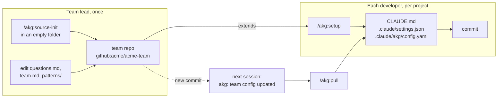
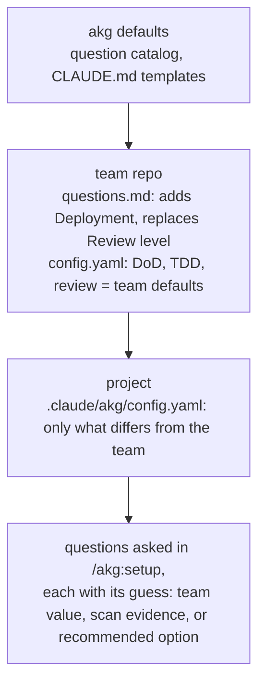
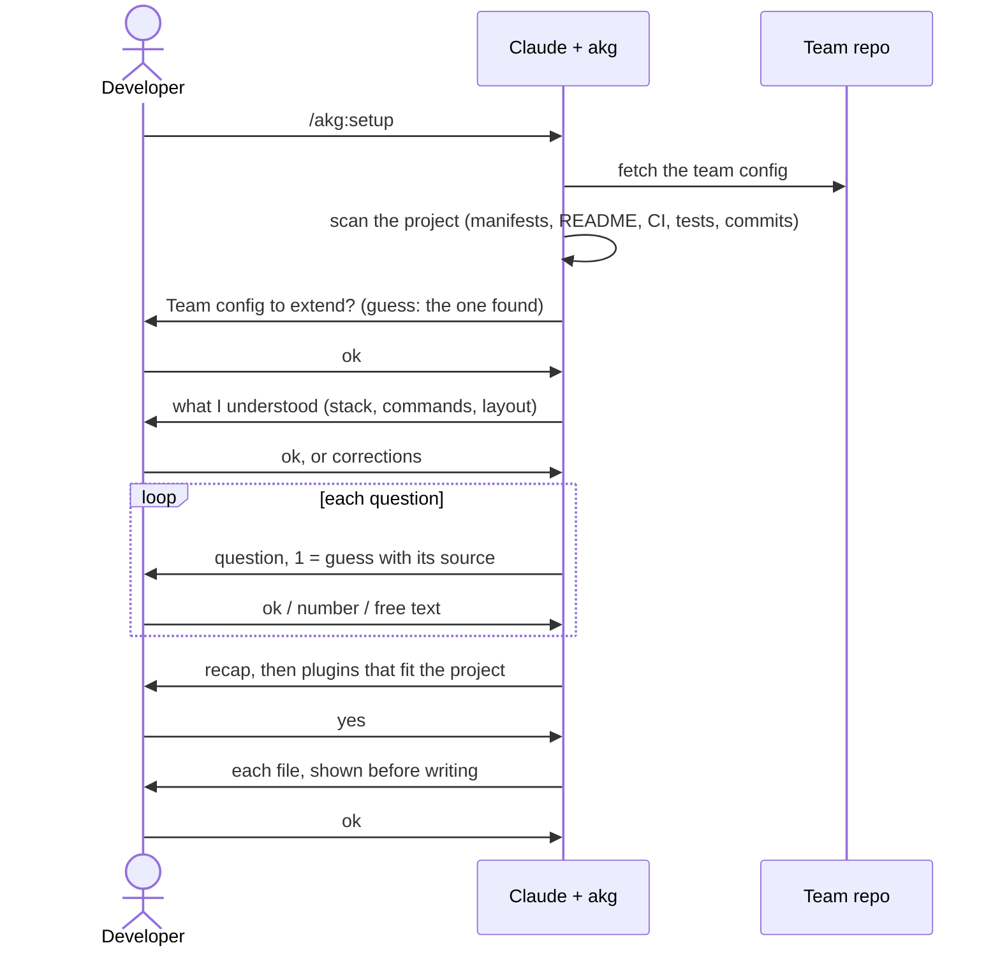
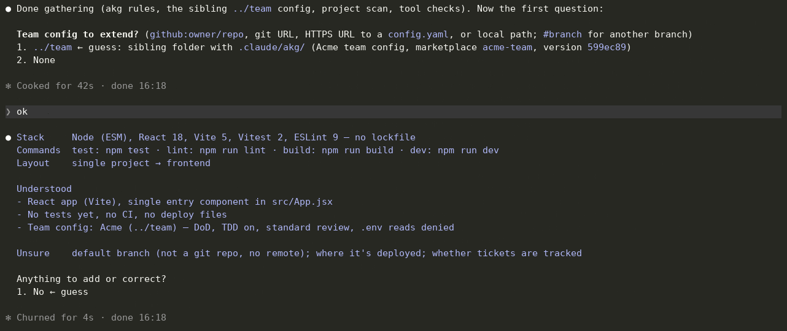
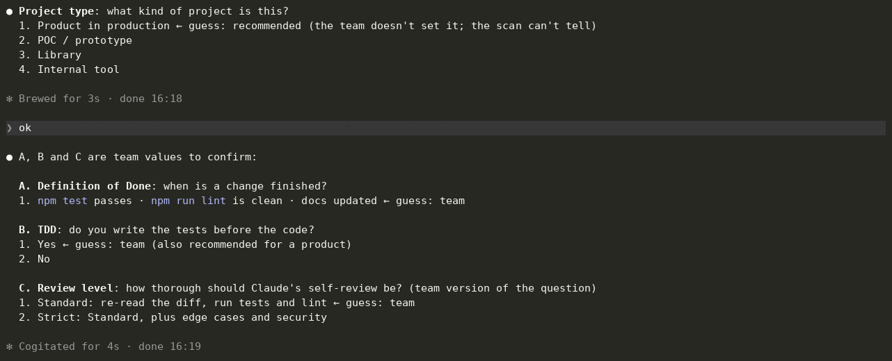
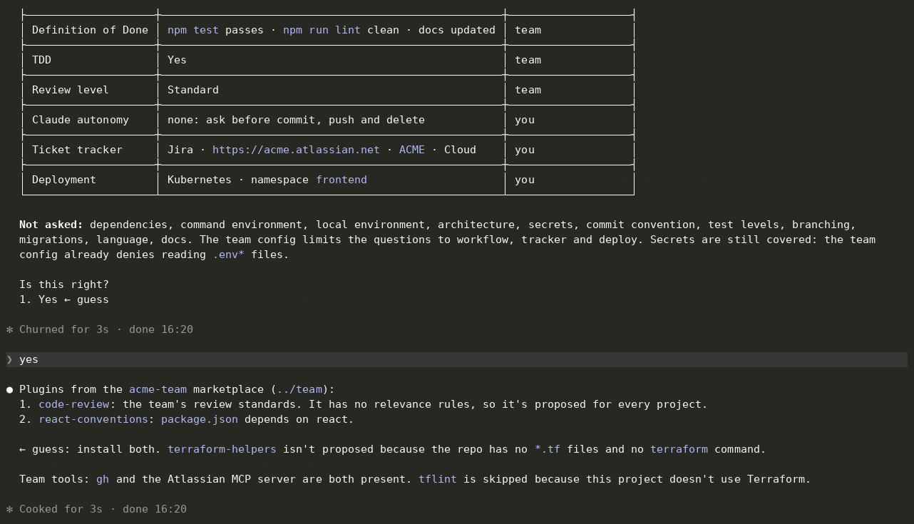
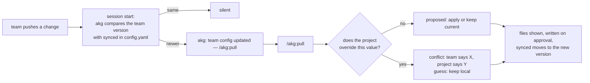

# Quickstart

A typical case: **Acme** has a front-end team. The lead creates a team repo once, with the team's conventions, one question of its own and the team's plugins. Then each developer runs `/akg:setup` in their project, and `/akg:pull` when the team changes something.



Install the plugin first (lead and developers):

```
/plugin marketplace add anthonykgross/akg
/plugin install akg@akg
```

## Part 1 — Create the team repo (team lead)

### 1. Run `/akg:source-init` in an empty folder

```bash
mkdir acme-team && cd acme-team && claude
```

```
/akg:source-init
```

akg asks, as an interview (answer `ok` to take its guess, a number, or your own words):

1. **The team's stacks** (front-end JS/TS, Node, Go, infra…). Not stored: they pick the plugins and decide which projects each one is offered to.
2. **The team's conventions**: project type, Definition of Done, TDD, review level, Claude autonomy, dependencies, secrets, ticket tracker. Questions that only make sense for one project (architecture, local tools, containers) are left to each project.
3. **Which optional questions projects should answer**: `deploy`, `git`, `tests`, `db`, `docs`.
4. **Plugins**: the ones you have installed, plus up to 6 official Anthropic plugins fitting the stacks, each with its reason. Then "Add more plugins?": skills, agents, commands and hooks copied from an existing project, the community catalog, or a repo URL.

It shows every file before writing it:

```
acme-team/
  .claude-plugin/marketplace.json   # the chosen plugins
  plugins/…                         # skills copied from your projects, if any
  .claude/akg/
    config.yaml                     # the team's answers
    team.md                         # skeleton: getting started, tools to install, rules
  README.md
```

`.claude/akg/config.yaml`: these answers become the defaults of every project:

```yaml
workflow:
  type: product
  dod:
    - Tests pass
    - Lint and type check pass
    - Build succeeds
    - Changed behaviour is covered by tests
  tdd: true
  review: standard
  autonomy: []
deps:
  policy: ask
security:
  secrets: env-files
tracker:
  tool: none
```

`.claude-plugin/marketplace.json`: a plugin with a `relevance` block is only offered to projects that match it; a plugin without one is offered everywhere:

```json
{
  "name": "acme-team",
  "owner": { "name": "Acme" },
  "plugins": [
    {
      "name": "code-review",
      "source": "./plugins/code-review",
      "description": "Review to the team's standards"
    },
    {
      "name": "react-conventions",
      "source": "./plugins/react-conventions",
      "description": "Team React conventions",
      "relevance": {
        "topic": "React",
        "signals": { "manifestDeps": [{ "file": "[/\\\\]package\\.json$", "pattern": "\"react\"\\s*:" }] }
      }
    }
  ]
}
```

### 2. Add a question of your own

Create `.claude/akg/questions.md`. Each question is a `##` title, the `config.yaml` key its answer goes to, the question, and its options. `→` lines tell Claude what to do with the answer: ask a follow-up, check something read-only, propose a `CLAUDE.md` line or a setting. They never install or change anything.

```markdown
## Deployment
key: deploy.target
Where is this project deployed?
- Kubernetes (recommended)
  → Ask the namespace (key: deploy.namespace): offer a detected value (k8s manifests) as option, otherwise ask in one plain-text message.
  → Check whether `kubectl` is on the PATH; if not, mention it.
- Lambda
  → CLAUDE.md: keep handlers small, cold start matters.
- None
→ If deployed: add the deployment target to the Project context.

## Review level
key: workflow.review
How thorough should Claude's self-review be? (team version)
- Standard (recommended): re-read the diff, run tests and lint
- Strict: standard, plus edge cases and security
```

- **A new title** adds a question (`Deployment`). **The same title as an akg question** replaces it (`Review level`). **A title followed by `skip`** removes one.
- Add `multiple` under `key:` when several options can be picked together.
- Add `per-project` under `key:` when the answer only makes sense for one project: `/akg:source-init` won't ask it for the team.

Then list which questions projects are asked, by key prefix, in `config.yaml`:

```yaml
questions: [workflow, tracker, deploy]
```

How a question reaches a developer: akg merges three layers, and the layer closest to the project wins.



### 3. Optional: templates and instructions

- **`.claude/akg/patterns/frontend.md`** (or `backend.md`, `common.md`): your conventions, used to write each project's `CLAUDE.md`. Claude adapts them to the project; they are not copied as is.

  ```markdown
  ## Team conventions

  - Components in PascalCase, one component per file.
  - State management: local state first, a store only when shared by 3+ components.
  - Every component has a test next to it (`Foo.test.jsx`).
  ```

- **`.claude/akg/team.md`**: free Markdown for developers (getting started, tools to install, rules). `/akg:team` shows it. `/akg:setup` checks the tools it lists, read-only, and gives the command of each missing one for the developer to run; akg never runs them.

  ```markdown
  ## Tools to install

  - **gh** — GitHub CLI, used to read issues and open PRs: `brew install gh && gh auth login`
  - **Atlassian MCP** — read Jira tickets from Claude: `claude mcp add --transport http atlassian https://mcp.atlassian.com/v1/sse`
  ```

### 4. Push

akg never pushes for you. Create the remote, then:

```bash
git remote add origin git@github.com:acme/acme-team.git
git push -u origin main
```

Developers give `github:acme/acme-team` as the team config (add `#<branch>` to follow another branch). A private repo works with the developer's git credentials.

## Part 2 — Set up a project (each developer)

### 1. Run `/akg:setup` in the project

```bash
cd my-react-app && claude
```

```
/akg:setup
```



akg reads the project and the team config before asking anything, then asks which team config to extend and shows what it understood. Reply `ok`, or correct it in your own words. (The screens below come from a local copy of the team repo, `../team`.)



### 2. Answer the questions

Answer 1 is always akg's guess, with where it comes from. Values the team already sets come up to three at a time, to confirm. Reply `ok`, a number (`2`, `B2`), or free text.



The team's own question shows up like the others: here Deployment, with its Kubernetes follow-up (the namespace).

### 3. Approve the recap, then the plugins

Each answer shows its source (`team` or `you`). Plugins come from the team's marketplace, each with the reason it fits: `react-conventions` because `package.json` depends on React; a Terraform plugin is left out. Missing team tools are listed with their command.



### 4. Review the files

Each one is shown before it is written. `CLAUDE.md` (excerpt; the conventions come from the team's template):

```markdown
## Workflow
1. Write a failing test first, then the code, then refactor.
2. Implement the change.
3. Review: re-read the diff, run `npm test` and `npm run lint` before handing over.
4. Done when:
   - [ ] `npm test` passes
   - [ ] `npm run lint` is clean
   - [ ] docs updated (README)

## Conventions
- Components in PascalCase, one component per file.
- Every component has a test next to it (`Foo.test.jsx`).
```

`.claude/settings.json`:

```json
{
  "permissions": {
    "allow": ["Bash(npm test)", "Bash(npm test *)", "Bash(npm run lint)", "Bash(npm run lint *)"],
    "ask": ["Bash(git commit *)", "Bash(git push *)", "Bash(rm *)"],
    "deny": ["Read(**/.env*)", "Bash(git push --force *)", "Bash(git push * main)"]
  },
  "extraKnownMarketplaces": { "acme-team": { "source": { "source": "github", "repo": "acme/acme-team" } } },
  "enabledPlugins": { "code-review@acme-team": true, "react-conventions@acme-team": true }
}
```

`.claude/akg/config.yaml`, with only what differs from the team, plus the answers to questions the team doesn't set:

```yaml
extends: github:acme/acme-team
synced: 599ec89…
workflow:
  type: product
  autonomy: []
tracker:
  tool: jira
  url: https://acme.atlassian.net
  project: ACME
  hosting: cloud
deploy:
  target: kubernetes
  namespace: frontend
```

### 5. Commit

Commit `.claude/` and `CLAUDE.md`: teammates who clone the project get the same setup.

## Part 3 — Keep in sync

When the lead pushes a change to the team repo (a new DoD item, a new question, a new plugin), each developer's next session shows one line:

```
akg: team config updated — /akg:pull
```



`/akg:pull` never overwrites a local choice without asking, and never touches the `## Project context` section of `CLAUDE.md`. A new team question is asked right away, if the team's `questions` list includes it.
